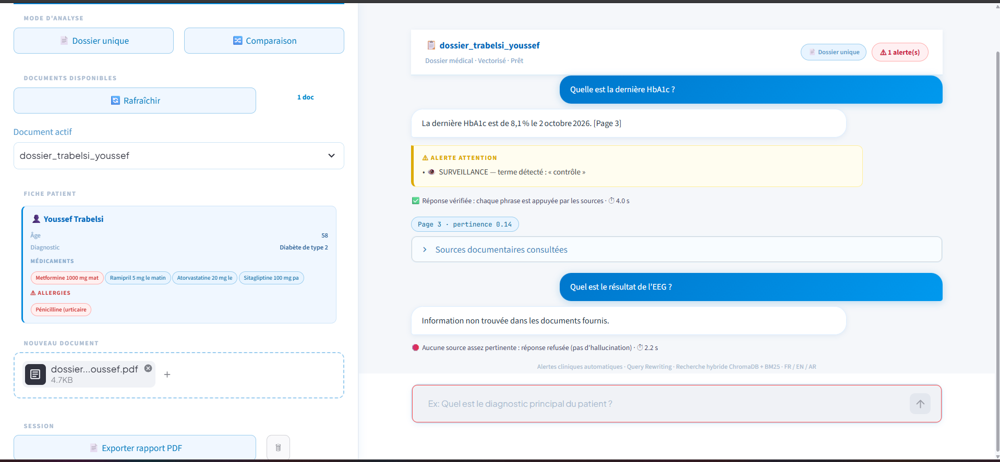
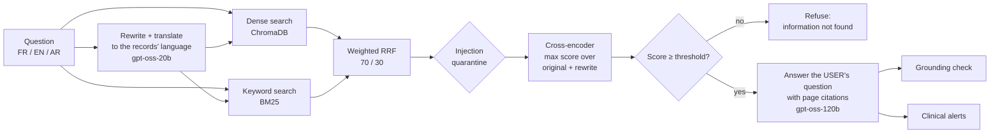

<div align="center">

# MedRAG
### Trustworthy Retrieval-Augmented Generation for clinical records

**Python 3.11** · **FastAPI** · **LangChain** · **ChromaDB + BM25** · **bge-reranker-v2-m3** · **Groq gpt-oss-120b** · **Streamlit**

Ask questions about patient records in French, English or Arabic. MedRAG answers **only** from the record, cites its pages, **refuses when the record does not contain the answer**, checks its own answer for unsupported sentences, and flags clinical risks.

</div>

> All patient data in this repository is fictional and generated for testing. MedRAG is a research prototype, not a medical device.



*Above: "Quelle est la dernière HbA1c ?" is answered from page 3 and verified by the grounding check. "Quel est le résultat de l'EEG ?" is refused by the relevance gate: this patient has no EEG, and the LLM is never called.*

---

## Results (held-out test set)

Measured with `scripts/evaluate.py` on questions that were **never used to tune the system** (dev/test split, one run, commit `37c22c8`, drug-class expansion not yet added). 95% confidence intervals are Wilson intervals: the benchmark is small, so they are wide.

| Metric | Test set (19 questions) | 95% CI |
|---|---|---|
| Answer accuracy (expected fact in the answer) | **90.9%** (10/11) | 62 – 98% |
| Refusal on unanswerable questions | **100%** (8/8) | 68 – 100% |
| Unanswerable questions answered anyway | **0** | |
| False refusal on answerable questions | 9.1% (1/11) | |
| Grounded answers (judge found no unsupported sentence) | 100% | |
| Retrieval hit@5 (right page among sources) | 90.9% | |
| Latency p50 / p95 (laptop CPU + Groq free tier) | 5.4 s / 20.0 s | |

Dev set (32 questions, used for tuning): 95% accuracy on 24 Oct and 90% on the two 5 Nov re-runs (*"Est-elle enceinte ?"* scores 0.0038, just above the 0.0034 threshold, and the LLM's wording varies between runs), 100% refusal, 0 unanswerable answered, 100% grounded. The p95 latency is dominated by Groq free-tier rate-limit retries.

Questions cover French, English, Arabic and typos; unanswerable ones include off-topic questions and **facts that belong to another patient** (the hard case). One record hides a prompt-injection attack, which is quarantined at ingestion. Full outputs: [`eval/RESULTS_test.md`](eval/RESULTS_test.md), [`eval/results_test.json`](eval/results_test.json).

### Latency and corpus size (measured 5 Nov 2026)

End-to-end time per question on the 32 dev questions (nearest-rank percentiles; model loading and the pause between questions excluded; no Groq rate-limit retry occurred in this run):

| | p50 | p95 |
|---|---|---|
| **End to end** | **4.25 s** | **9.13 s** |
| Search: ChromaDB + BM25 + bge reranker (local CPU) | 1.25 s | 2.62 s |
| LLM: rewrite + answer + grounding judge (Groq API, network included) | 2.75 s | 7.75 s |

Machine: Intel Core i5-13450HX (16 logical cores), 39.7 GB RAM, **CPU only (no GPU)**, Windows 11, Python 3.11, torch 2.14.1+cpu. LLMs: `openai/gpt-oss-120b` (answer) and `openai/gpt-oss-20b` (rewrite, judge) on Groq. Answered questions alone: p50 5.48 s (refused ones skip the answer and the judge). Full output: [`eval/RESULTS_dev_latency.md`](eval/RESULTS_dev_latency.md).

Indexed corpus (`python -m scripts.corpus_stats`; document = one PDF, page = a page that produced at least one chunk, chunk = 600 characters):

| Index | Documents | Pages | Chunks |
|---|---|---|---|
| Demo (`data/chroma_db`, screenshot above) | 1 | 4 | 4 |
| Evaluation (`eval/chroma_db`) | 4 | 15 | 15 (1 quarantined for prompt injection) |

These are small, fictional records: the latency numbers say nothing about long documents (see Limitations).

### Drug-class expansion (dev evidence only)

The single test error was *"Quel bêtabloquant prend-il ?"*: the record says *"Bisoprolol"*, and nothing links the two words. `app/drug_classes.py` maps common drug classes (French, with English and Arabic variants) to their molecules; when a question names a class, MedRAG searches with one extra query listing the molecules. The LLM still answers the user's own question and must still refuse if no molecule of that class is in the record.

It was evaluated on **17 new dev questions committed before the fix** (`eval/questions_dev_classes.json`, see the git history): 11 answerable, and 6 traps that name a class the patient does **not** take. Same threshold (0.0034), nothing tuned on them.

| 17 new dev questions | Expansion off | Expansion on |
|---|---|---|
| Answer accuracy | 4/11 (36%, CI 15–65%) | **10/11 (91%, CI 62–98%)** |
| Retrieval hit@5 | 4/11 | 11/11 |
| Traps refused | 6/6 (gate 5, LLM 1) | **6/6** (gate 4, LLM 2) |
| Latency p50 (search p50) | 3.77 s (1.54 s) | 6.54 s (3.03 s) |

Paired on the same questions: 6 went from wrong to right, 0 from right to wrong (exact McNemar p ≈ 0.03, a small-sample signal, not a general claim). No regression on the 32 dev questions: 18/20 correct and 12/12 refused, with and without expansion, same two errors. Costs, stated plainly: about +1.5 s of search on questions that name a class (one more query for the reranker), and one trap now passes the gate and is refused only by the LLM, so the gate's margin is smaller. The remaining error (*"bêta-2 agoniste de longue durée"*) retrieves the right page but the LLM refuses. **The held-out test set cannot measure this fix** (it revealed the problem, and the table was written knowing it); a new test set is needed. Expansion is on by default; set `DRUG_CLASS_EXPANSION=false` to reproduce the test-set configuration.

---

## Why "trustworthy"

A plain RAG demo always answers, even when retrieval found nothing useful. In a clinical setting, that is how hallucinations happen. MedRAG puts safety layers around the LLM:

| Layer | What it does | Where |
|---|---|---|
| **1. Relevance gate** | A multilingual cross-encoder (`BAAI/bge-reranker-v2-m3`) scores each retrieved chunk against the question. Below `RELEVANCE_THRESHOLD`, a chunk is dropped; if none is left, MedRAG answers *"Information non trouvée"* **without calling the LLM**. On the test set the gate alone refused 8/8 unanswerable questions. | `app/rag_pipeline.py`, `app/reranker.py` |
| **2. LLM refusal rule** | The answer prompt only allows facts from the documents and a fixed refusal sentence. This is the second line of defence for hard negatives that pass the gate. | `app/llm_chain.py` |
| **3. Grounding check** | After generation, a small LLM judge lists every sentence the sources do not support; the UI shows them. | `app/grounding.py` |
| **4. Retrieval security** | Uploads are validated (real PDF by content, size, pages, not encrypted) and stored under random names. Chunks with prompt-injection text (EN/FR/AR patterns) are quarantined and never reach the LLM. Documents reach the LLM inside `<document>` tags marked as data. All model and document text is HTML-escaped in the UI. | `app/guardrails.py`, `frontend/ui.py` |
| **5. Clinical alerts** | Whole-word, negation-aware detection in 4 levels (ATTENTION → URGENCE) and high-risk drugs: *"Allergie : pénicilline"* alerts, *"Aucune allergie connue"* does not. | `app/alert_detector.py` |

Each PDF gets its own ChromaDB collection, so a question about one patient never retrieves another patient's chunks.

---

## Pipeline



- **Query translation**: the rewrite turns the question into a natural question in the records' language (`DOCUMENT_LANGUAGE`, French by default), so an English or Arabic question still matches a French record. The prompt forbids changing the meaning.
- **Max over both queries**: each chunk is scored against the original **and** the rewritten question. The rewriting LLM is not deterministic; taking the max means a bad rewrite can never hide a chunk that the user's own words find.
- **The answer addresses the user's question**, never the rewrite, in French, English or Arabic.

---

## How the design was chosen (evaluation-driven)

Every choice below was measured on the **dev** questions; the test set was used once, at the end.

**Reranker** (raw questions, same pipeline, only the reranker changes):

| Cross-encoder | ROC-AUC | Leave-one-out balanced acc. | Retrieval + rerank p50 (CPU) |
|---|---|---|---|
| FlashRank `ms-marco-MultiBERT-L-12` (quantized ONNX) | — | 50% (chance) | — |
| `cross-encoder/mmarco-mMiniLMv2-L12-H384-v1` (118M) | 0.838 | 73% | 140 ms |
| **`BAAI/bge-reranker-v2-m3` (568M)** | **0.967** | **88%** | 1.3 s |

- MultiBERT was rejected: off-topic French questions scored 0.999 against medical chunks, and the **same (question, chunk) pair scored 0.0033 or 0.6675 depending on the other passages in the batch** (`scripts/diagnose_reranker.py`).
- bge was adopted under a rule fixed **before** the run (≥ +5 points leave-one-out and p50 < 1.5 s). mmarco stays available as a ~10× faster option via `RERANKER_MODEL`.
- With query translation and max scoring, the final gate reaches ROC-AUC 0.979 and leave-one-out balanced accuracy 93% on dev.

**Threshold**: chosen by a rule fixed in advance: the highest threshold that keeps ≥ 95% of answerable dev questions (`--target-recall`). The gate is a cheap first filter; the LLM refuses what passes. The in-sample "best" threshold was reported next to the leave-one-out estimate to expose tuning on the test set (80% vs 73% in one run).

**Chunk size**: 600 characters beat 300 and 200 (ROC-AUC 0.84 vs 0.71 and 0.70). Smaller chunks give an unanswerable question more chances to match one chunk by accident (the max score rises).

**Error analysis on dev** fixed real bugs: the LLM was answering the rewritten question instead of the user's; a French question with typos was answered in Italian; an English question did not match the French record; an early rewrite prompt turned "Who won the 2022 World Cup?" into a clinical question. Each fix is described in the code.

---

## Getting started

### 1. Install

```bash
git clone https://github.com/Abd-Elmouhib-Souri/MedRag.git
cd MedRag
conda create -n medrag python=3.11 -y
conda activate medrag
pip install -r requirements.txt
```

### 2. Configure

```bash
cp .env.example .env        # Windows: copy .env.example .env
```

Put your free Groq key in `.env` (`GROQ_API_KEY=...`, from [console.groq.com](https://console.groq.com)). Every other setting has a default (see `.env.example`). Check that your key can use the models: `python -m scripts.check_llm`. Groq retires models regularly; change `MODEL_FAST` / `MODEL_STRONG` in `.env` if needed.

### 3. Run

```bash
uvicorn app.main:app --port 8000      # API + Swagger docs at http://localhost:8000/docs
streamlit run frontend/ui.py          # UI at http://localhost:8501 (second terminal)
```

The first start downloads the embedding model (~470 MB) and the reranker (~2.3 GB). The API loads both at startup, so the first question is not slow. Once they are cached, `HF_HUB_OFFLINE=1` skips the online version checks. On Windows, set `PYTHONIOENCODING=utf-8` before `uvicorn`.

### 4. Test

```bash
pytest
```

The **38 tests** run offline, without an API key or model download (fake embeddings, LLM and reranker). They cover upload validation, injection quarantine, the relevance gate (an off-topic question is refused **and the LLM is never called**), the gate's resistance to a bad rewrite, the answer using the user's question, grounding, negation-aware alerts, rank fusion, the ChromaDB fallback, drug-class expansion and API errors. Key tests were mutation-checked: removing the protected behaviour makes them fail.

### 5. Reproduce the evaluation

```bash
python -m scripts.make_eval_corpus                         # 4 records, dev (32) + test (19) questions
python -m scripts.evaluate --calibrate --rewrite           # dev: ROC-AUC, leave-one-out, threshold
python -m scripts.evaluate --split dev  --threshold 0.0034 # dev, full pipeline
python -m scripts.evaluate --split test --threshold 0.0034 --drug-classes off # held-out test, run once (37c22c8 config)
python -m scripts.evaluate --split dev --tag dev_latency --drug-classes off   # latency breakdown + machine
python -m scripts.evaluate --split dev_classes --drug-classes off             # drug classes, before
python -m scripts.evaluate --split dev_classes --drug-classes on              # drug classes, after
python -m scripts.corpus_stats                                               # documents, pages, chunks
```

`--calibrate` on any split other than dev is refused on purpose. Results vary slightly between runs because the rewriting LLM is not fully deterministic.

---

## API

| Method | Endpoint | Description |
|---|---|---|
| `GET` | `/` | Health check and active settings (models, threshold) |
| `GET` | `/collections` | Indexed documents |
| `GET` | `/summaries` · `/summaries/{name}` | Patient cards |
| `POST` | `/ingest` | Upload a PDF (`multipart/form-data`: `file`, optional `collection_name`) |
| `POST` | `/ask` | Question on one record → `answer`, `sources` (page + relevance score), `refused`, `grounding`, `alert`, `retrieval`, `timings_ms` |
| `POST` | `/compare` | Compare 2+ records |
| `POST` | `/report` | Export the conversation as PDF |
| `DELETE` | `/collections/{name}` | Remove a document |

---

## Project structure

```
app/
├── main.py             # FastAPI endpoints, model warm-up at startup
├── config.py           # every setting, overridable by environment variables
├── rag_pipeline.py     # rewriting/translation, hybrid retrieval, RRF, relevance gate, answer, comparison
├── reranker.py         # cross-encoder (sentence-transformers; FlashRank kept as an option)
├── grounding.py        # post-generation groundedness check
├── guardrails.py       # upload validation, prompt-injection screening
├── alert_detector.py   # negation-aware clinical alerts
├── vector_store.py     # per-patient ChromaDB collections (+ fallback for a ChromaDB 1.5 bug)
├── document_loader.py  # PDF extraction and chunking
├── embeddings.py       # multilingual embeddings
├── llm_chain.py        # LLM factory and answer prompt
├── drug_classes.py     # drug class -> molecules table, query expansion
├── patient_summary.py  # patient cards
└── report_generator.py # PDF reports
frontend/ui.py          # Streamlit interface
scripts/                # evaluation corpus and evaluation, corpus stats, model checks, reranker diagnosis
eval/                   # questions (dev, test, dev_classes) and results
tests/                  # pytest suite (offline)
```

---

## Limitations

- **Small, fictional benchmark** (4 records, 51 questions). The confidence intervals are wide, and the results do not transfer to real clinical data without a proper study.
- **Vocabulary gaps remain.** The drug-class table is small, hand-written and only evaluated on dev questions (see above); a class it does not list falls back to the old behaviour. Other synonyms are not covered (dev error: *"inhalateur de secours"* vs *"Traitement de crise : Salbutamol"*). Future work: a standard ontology (e.g. ATC classes) and a new held-out test set.
- **Latency on long records is not measured**: the benchmark and demo records have 3–4 chunks each.
- A rewrite that only changes punctuation (*"départ ?"* → *"départ?"*) is treated as a second query, so the reranker works twice (about +1 s, visible in the latency run). Not yet optimised. `RERANK_TOP_N` (8) caps the cross-encoder cost, which is about 0.3 s per (question, chunk) pair for bge on a laptop CPU.
- The grounding judge is itself an LLM and can miss unsupported sentences.
- Scanned PDFs (images without text) are not supported (no OCR).
- Injection screening is pattern-based: it stops common attacks, not every possible one.
- ChromaDB 1.5.9 can fail to open its vector index on Windows ("Nothing found on disk"); MedRAG then falls back to an exact in-memory search over the same chunks.

---

## Author

**Abd Elmouhib Souri** — final-year engineering student, Data Science & AI, ESPRIM (Tunisia)

[LinkedIn](https://linkedin.com/in/abd-elmouhib-souri) · [GitHub](https://github.com/Abd-Elmouhib-Souri) · [Portfolio](https://abd-elmouhib-souri.github.io)
